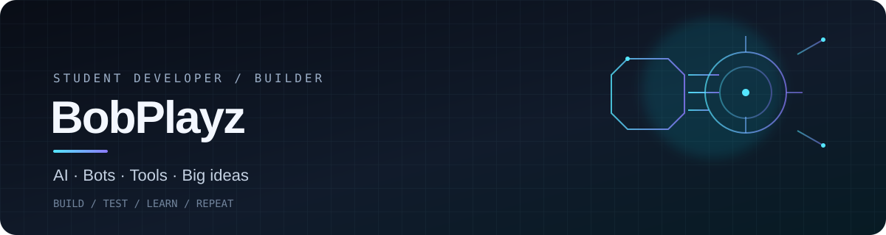

### student developer · AI builder · professional scope-creep enjoyer

I get an idea, start coding, and somehow the project has 40 more features than planned.

---

## 01 / Projects

<table>
<tr>
<td width="50%" valign="top">

### 🤖 [BobAI](https://github.com/BobPlayz/BobAi)

My main project: an AI platform bringing together model providers, memory, tools, file understanding, agents, automations, and APIs.

**The goal:** an assistant that can do more than just chat.

</td>
<td width="50%" valign="top">

### 🎮 [BobBot](https://github.com/BobPlayz/BobBot)

A Discord bot with economy commands, games, giveaways, and server utilities.

A place to build features people can actually use and experiment with bot development.

</td>
</tr>
</table>

I also build other things, including a counting bot and a coding-agent system. Those repos are private for now.

## 02 / Things I’m into

| | Area | What interests me |
|:--:|:--|:--|
| 🧠 | **AI & LLMs** | Models, memory, tools, and assistant capabilities |
| 🧩 | **Coding agents** | Agents, orchestration, and workspace tools |
| ⚙️ | **Backend** | APIs, databases, services, and integrations |
| 🤖 | **Bots & automation** | Useful commands and fewer repetitive tasks |
| 🌐 | **Web development** | Interfaces connected to real functionality |

## 03 / Current side quests

- Building out BobAI and experimenting with new capabilities
- Improving my bots and trying new ideas
- Learning more about APIs, backend systems, and AI tooling
- Figuring out how to make big projects less chaotic

## 04 / My build philosophy

- **Learn by building.** I understand things better when I actually make them.
- **Experiment freely.** Try the idea, find the limits, then improve it.
- **Debug instead of bluffing.** Broken things are usually clues.
- **No fake expertise.** I'm learning as I go, so I'd rather show real projects than decorate this page with a hundred skill badges.

---

**still learning · still building · still adding features**

Explore the repos and see what I'm working on.

